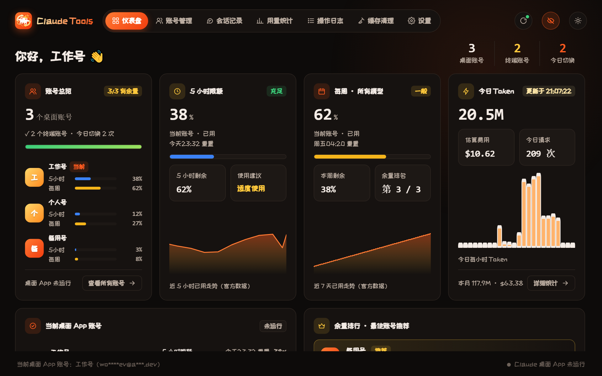
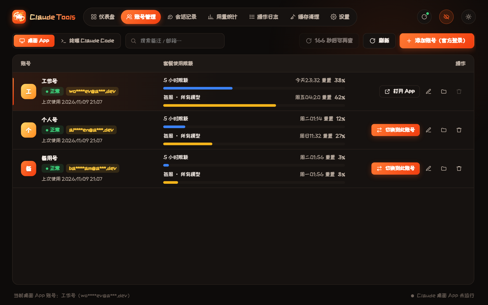
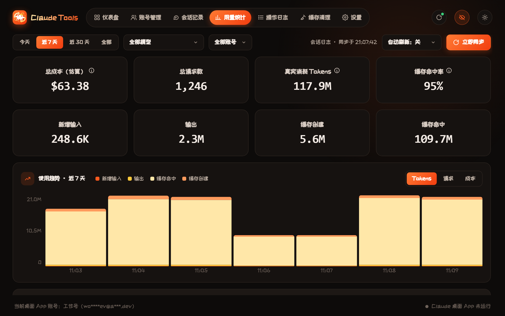
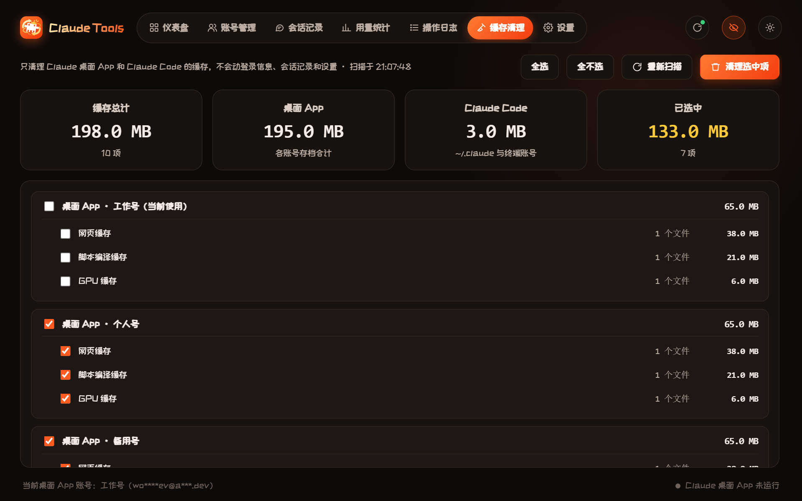
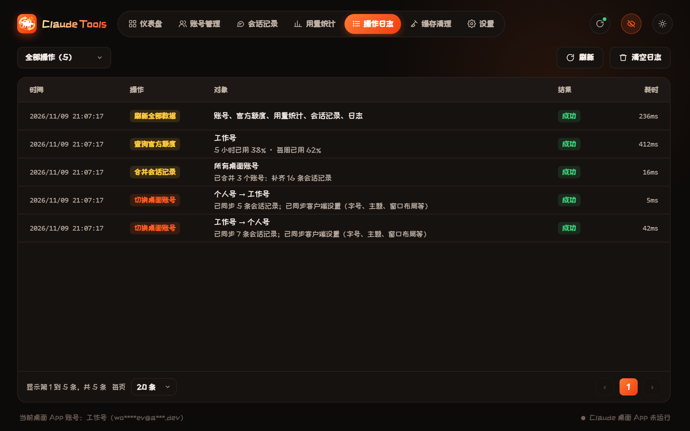
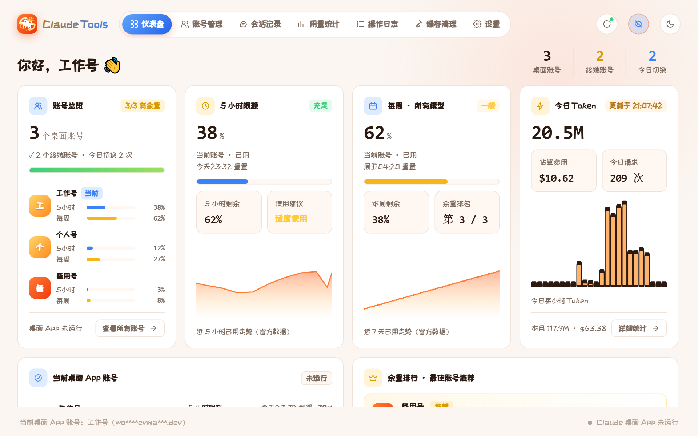
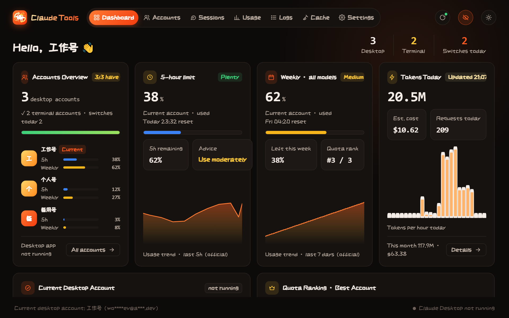
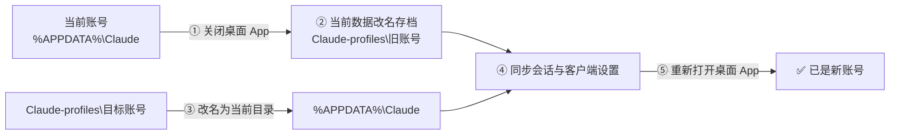
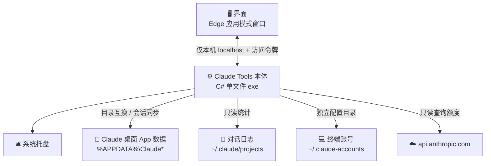

<div align="center">


### 🔀 一个窗口管好你所有的 Claude 账号

**✨ 一键切换桌面 App 账号 · 会话记录不丢 · 官方额度实时看 · Token 用量一目了然 ✨**

<br />

[](https://github.com/2014-y/Claude-Tools/releases/latest)
[](https://github.com/2014-y/Claude-Tools/releases)
[](#-系统要求)
[](#-系统要求)
[](https://github.com/2014-y/Claude-Tools/releases/latest)
[](#-个性化设置)
[](LICENSE)

<br />

[🚀 快速开始](#-快速开始) •
[✨ 核心功能](#-核心功能) •
[🖼️ 界面一览](#️-界面一览) •
[📖 功能详解](#-功能详解) •
[⚙️ 工作原理](#️-工作原理) •
[🔒 隐私与安全](#-隐私与安全) •
[❓ 常见问题](#-常见问题)

<br />



<sub>📸 截图使用的是虚构的演示账号和数据</sub>

</div>

<br />

> [!IMPORTANT]
> **非官方工具**，与 Anthropic 无关。Claude 是 Anthropic 的商标。请只用它管理**你自己的**账号，并遵守 [Anthropic 的服务条款](https://www.anthropic.com/legal/consumer-terms)。

---

## 💡 为什么需要它

手上有好几个 Claude 账号（工作号、个人号、备用号……），用官方桌面 App 时会遇到这些麻烦：

| 😫 没有 Claude Tools | 😎 有了 Claude Tools |
|---|---|
| 换号要**退出登录 → 重新登录**，每次都要走一遍邮箱验证 | 点一下「**切换到此账号**」，几秒后桌面 App 已是新账号，**不用重新登录** |
| 换号后**之前的会话全没了**，Claude Code 对话没法继续 | 会话记录**自动跟随**到新账号，打开就能接着聊 |
| 不知道哪个号**还剩多少额度**，只能一个个登录去看 | 所有账号的 **5 小时限额 / 每周限额**放在一页里，和官方显示一致 |
| 不清楚每天到底**用了多少 Token**、花了多少钱 | 按天 / 模型 / 账号 / 项目统计 Token、请求数、缓存命中率和估算费用 |
| 字号、主题、窗口布局每个号都要**重新调一遍** | 切换时客户端设置一起带过去 |

---

## ✨ 核心功能

<table width="100%">
<tr>
<td width="33%" valign="top">
<h3>🔀 一键切换账号</h3>
<p>每个账号保存一整套独立的登录数据。切换时自动关闭并以新账号重新打开 Claude 桌面 App，<b>无需重新登录</b>；新账号走官方登录流程添加。</p>
</td>
<td width="33%" valign="top">
<h3>💬 会话记录跟随</h3>
<p>切换时把上一个账号的会话同步到新账号；后台每 5 分钟自动合并所有账号的会话，在任何一个号里都能<b>接着之前的对话</b>。删掉的会话不会「复活」。</p>
</td>
<td width="33%" valign="top">
<h3>📊 官方实时额度</h3>
<p>直接用每个账号已有的登录读取<b>官方</b>的 5 小时限额和每周限额，显示样式和官方一致。打开即查，之后每 3 分钟自动更新。</p>
</td>
</tr>
<tr>
<td width="33%" valign="top">
<h3>🪙 Token 用量统计</h3>
<p>读取本机对话日志，统计 Token、请求数、缓存命中率和估算费用；按时间、模型、账号、项目筛选，带趋势图和最多 5000 条请求日志，单价可自行修改。</p>
</td>
<td width="33%" valign="top">
<h3>💻 终端 Claude Code 多账号</h3>
<p>每个终端账号使用独立的配置目录，共享同一份历史对话；选好项目文件夹，一键「新对话 / 历史 / 继续」。没装 Claude Code 也能一键安装。</p>
</td>
<td width="33%" valign="top">
<h3>🧹 缓存清理</h3>
<p>扫描并清理桌面 App 和 Claude Code 的网页缓存、脚本编译缓存、GPU / 着色器缓存、崩溃报告等，<b>不碰</b>登录信息、会话和设置。</p>
</td>
</tr>
<tr>
<td width="33%" valign="top">
<h3>🎨 个性化</h3>
<p>深色 / 浅色 / 跟随系统，6 种主题色，6 种字体，简体中文 / 繁體中文 / English，可隐藏不用的菜单，界面字号可调。</p>
</td>
<td width="33%" valign="top">
<h3>🛎️ 托盘常驻</h3>
<p>关窗后留在托盘，右键托盘图标快速切换账号；可开机自启（只在托盘，不弹窗口）；切换成功 / 失败会弹通知。</p>
</td>
<td width="33%" valign="top">
<h3>🔒 数据只在本机</h3>
<p>不需要服务器，不上传任何数据。账号邮箱默认脱敏显示，界面禁止复制，所有操作都记录在操作日志里。</p>
</td>
</tr>
</table>

---

## 🖼️ 界面一览

<table>
<tr>
<td width="50%"><p align="center"><b>👥 账号管理</b> · 每个账号的官方限额、重置时间，一键切换</p></td>
<td width="50%"><p align="center"><b>📈 用量统计</b> · Token、费用、缓存命中率与趋势</p></td>
</tr>
<tr>
<td width="50%"><p align="center"><b>💬 会话记录</b> · 所有账号的会话，一键合并</p></td>
<td width="50%"><p align="center"><b>💻 终端 Claude Code</b> · 多账号独立登录，共享历史</p></td>
</tr>
<tr>
<td width="50%"><p align="center"><b>🧹 缓存清理</b> · 只清缓存，不动登录和会话</p></td>
<td width="50%"><p align="center"><b>📜 操作日志</b> · 每次切换、合并、查询都有记录</p></td>
</tr>
<tr>
<td width="50%"><p align="center"><b>🌞 浅色主题 + 天蓝主题色</b></p></td>
<td width="50%"><p align="center"><b>🌐 English 界面</b></p></td>
</tr>
<tr>
<td colspan="2"><p align="center"><b>⚙️ 设置</b> · 开机自启、托盘、自动刷新、会话同步、外观、语言、字体</p></td>
</tr>
</table>

---

## 🚀 快速开始


> [!TIP]
> **只需要两样东西**：一台 Windows 10 / 11 电脑，和已经安装好的 [Claude 桌面 App](https://claude.ai/download)。不需要装 Python、Node.js 或任何运行库。

### 1️⃣ 下载安装

到 [**Releases 发布页**](https://github.com/2014-y/Claude-Tools/releases/latest) 下载：

| 文件 | 说明 |
|---|---|
| 📦 `Claude-Tools-Setup.exe` | **推荐**。安装向导，可选桌面快捷方式、开始菜单、开机自启，带卸载程序 |
| ⚡ `Claude.Tools.exe` | 免安装单文件版，放在任意文件夹双击即用 |

安装默认放在 `%LOCALAPPDATA%\Programs\Claude Tools`，**不需要管理员权限**，也可以在向导里选别的位置。

<details>
<summary>🛠️ 静默安装（批量部署用）</summary>

```bat
Claude-Tools-Setup.exe /S "/D=D:\Claude Tools" /desktop /startmenu /autostart
```

| 参数 | 作用 |
|---|---|
| `/S` | 静默安装，不显示向导 |
| `/D=路径` | 安装位置 |
| `/desktop` | 创建桌面快捷方式 |
| `/startmenu` | 创建开始菜单快捷方式 |
| `/autostart` | 开机自动在托盘启动 |
| `/uninstall` | 卸载 |

</details>

### 2️⃣ 保存第一个账号

打开 Claude Tools，**当前已经登录在桌面 App 里的账号会自动识别并保存**，不需要任何操作。

### 3️⃣ 添加更多账号

进入「👥 **账号管理**」，点「**➕ 添加账号（官方登录）**」，给新账号起个备注名（比如「工作号」）：

1. Claude Tools 会自动关闭桌面 App，并打开一个**全新的官方登录页**；
2. 用另一个账号正常登录；
3. 登录完成后，这个账号就保存好了。之前的账号也已保存，随时一键切回。

### 4️⃣ 切换账号

在账号列表里点「**🔀 切换到此账号**」，或者在仪表盘点「**⚡ 一键切换到余量最多的账号**」。桌面 App 会自动重启成新账号，之前的会话和客户端设置都会带过去。

> [!NOTE]
> 切换时桌面 App 会被关闭再打开，**正在进行的对话会中断**。设置里默认开启了「切换前确认」。

---

## 📖 功能详解

### 🔀 1. 桌面 App 账号切换



- 每个账号保存一整套独立的桌面 App 数据目录，切换就是**两个目录互换位置**，所以不用重新登录。
- 任何一步失败都会**自动回滚**，不会把账号数据弄丢。
- 账号状态会显示 🟢 正常 / 🔴 异常（例如登录已失效），邮箱默认脱敏。

### 💬 2. 会话记录跟随与合并

| 功能 | 说明 |
|---|---|
| **切换时同步会话记录** | 把上一个账号的全部会话带到新账号，切过去后还能看到、继续之前的对话 |
| **自动合并所有账号的会话** | 启动时、每 5 分钟、每次切换后，把各账号的会话互相补齐（不会关闭桌面 App） |
| **手动合并** | 「💬 会话记录」页点「合并所有账号的会话记录」 |
| **删除同步** | 在任何账号里删掉的会话，不会被同步「复活」 |

> [!TIP]
> 对话内容本身保存在 `~/.claude/projects`，所有账号共用，所以合并后在任何账号里都能接着聊。

### 📊 3. 官方实时额度

显示方式和 Claude 桌面 App 左下角的「套餐使用限额」一致：

```text
5 小时限额                     周二 00:30 重置  38%
████████████░░░░░░░░░░░░░░░░░░░░░░░░░░░░░░░░░░░░
每周 · 所有模型                 周五 07:00 重置  62%
██████████████████████████████░░░░░░░░░░░░░░░░░░
```

- **数据来源**：直接用每个账号在桌面 App 里已有的登录，只读地调用官方用量接口。**不需要再登录，不弹任何窗口。**
- **更新频率**：打开工具时查一次，之后每 3 分钟自动更新；按钮上会显示「xx 秒后可再查」。
- **限流保护**：官方会限制查询频率。被限流时自动等待（最长 3 分钟），期间照常显示最近一次的数据；重启工具也不会提前查询。
- **仪表盘**：5 小时 / 每周限额卡片、近 5 小时与近 7 天的用量走势图、所有账号的余量排行和「一键切换到余量最多的账号」。

### 🪙 4. Token 用量统计

- 读取本机 `~/.claude/projects` 下的对话日志，**按消息去重**后统计。
- 指标：总成本（估算）、总请求数、真实消耗 Tokens、缓存命中率、新增输入 / 输出 / 缓存创建 / 缓存命中。
- 筛选：今天 / 近 7 天 / 近 30 天 / 全部，按模型、按账号；可开启自动刷新。
- 汇总：按模型、按账号、按项目目录（前 30），以及最多 5000 条请求日志（分页）。
- 「定价」页可修改每个模型的单价，按模型名前缀匹配。

> [!NOTE]
> 费用是按 API 单价估算的**等价费用**，订阅账号实际并不按这个计费，仅供参考。

### 💻 5. 终端 Claude Code 多账号

- 每个终端账号使用独立的 `CLAUDE_CONFIG_DIR`（`%USERPROFILE%\.claude-accounts\<账号>`），登录互不干扰。
- `projects` 等目录通过链接共享到 `~/.claude`，**所有账号共用同一份历史对话**。
- 选择项目文件夹（支持常用项目一键选），点「▶️ 新对话」「🕘 历史」「➡️ 继续」直接在新终端里启动。
- 自动检测 Claude Code；没安装时可以一键运行官方安装脚本。
- 和桌面 App 账号互不影响，不同账号可以同时开多个终端。

### 🧹 6. 缓存清理

扫描桌面 App（当前账号和所有存档账号）以及 Claude Code 的缓存，勾选后清理：

`网页缓存` · `脚本编译缓存` · `GPU 缓存` · `图形 / 着色器缓存` · `Service Worker 缓存` · `崩溃报告` · `Claude Code 缓存` · `本地遥测缓存` …

> [!TIP]
> 只删缓存文件，Claude 需要时会自动重建；**登录信息、会话记录和设置不受影响**。清理当前账号的缓存时会先关闭桌面 App，清理完自动重新打开。

### 🎨 7. 个性化设置

| 设置 | 选项 |
|---|---|
| 🌗 外观 | 深色 / 浅色 / 跟随系统 |
| 🎨 主题色 | 橙红（默认）/ 天蓝 / 紫罗兰 / 翠绿 / 樱粉 / 青碧 |
| 🔤 界面字体 | 站酷快乐体（默认）/ 微软雅黑 / 等线 / 黑体 / 楷体 / 宋体 |
| 🌐 语言 | 简体中文 / 繁體中文 / English |
| 🔍 界面字号 | 90% / 100% / 112% / 125%，小窗口自动略缩 |
| 📋 显示的菜单 | 勾选要显示在顶部的菜单（设置始终显示） |
| 🙈 默认脱敏显示 | 隐藏邮箱中间部分，右上角眼睛按钮可临时切换 |
| 🔄 自动刷新全部数据 | 每 1 / 3 / 5 / 10 分钟，或关闭 |

### 🛎️ 8. 托盘与开机自启

- **关闭窗口后继续后台运行**：留在右下角托盘，右键托盘图标可以快速切换账号。
- **开机自动启动**：登录 Windows 后只在托盘启动，不弹窗口（默认关闭）。
- **托盘通知**：切换成功 / 失败时在右下角提示。
- 只会运行一个实例；再次打开会直接激活已有窗口。

---

## ⚙️ 工作原理



| 位置 | 内容 |
|---|---|
| `%APPDATA%\Claude` | 当前桌面 App 账号的数据 |
| `%APPDATA%\Claude-profiles\<id>` | 其他账号的存档 |
| `%USERPROFILE%\.claude\projects` | 对话记录（所有账号共用），用量统计的数据来源 |
| `%USERPROFILE%\.claude-accounts\<id>` | 终端 Claude Code 各账号 |
| `%LOCALAPPDATA%\ClaudeSwitcher` | 本工具的设置、操作日志、定价、额度缓存 |

---

## 🔒 隐私与安全

- ✅ **所有数据都在本机**，没有服务器，不收集、不上传任何信息。
- ✅ **只访问官方地址**：除了查询额度时访问 `api.anthropic.com`，不会连接任何其他网络地址。
- ✅ **登录信息只读**：查额度时读取桌面 App 在本机保存的登录（由 Windows 加密），只用来调用官方用量接口；**不续期、不修改、不保存副本**，不影响桌面 App 的登录状态。
- ✅ **界面只监听本机**：内置服务只绑定 `localhost`，每个请求都要带本机生成的访问令牌，其他程序无法随意调用。
- ✅ **可审查**：完整源码公开，用 Windows 自带的编译器就能自己编译。

---

## ❓ 常见问题

<details>
<summary><b>切换账号会丢失会话吗？</b></summary>

不会。默认开启「切换时同步会话记录」和「自动合并所有账号的会话记录」，对话内容本身也保存在所有账号共用的 `~/.claude/projects`。新同步过来的会话，在桌面 App 里退出再打开一次就能看到。
</details>

<details>
<summary><b>额度显示「xx 秒后可再查」，为什么不能一直刷新？</b></summary>

官方接口会限制查询频率，查得太勤会被暂时拒绝。工具每 3 分钟查一次，被限流时会自动等待，期间照常显示最近一次的数据。
</details>

<details>
<summary><b>额度显示「--」怎么办？</b></summary>

说明这个账号还没在桌面 App 里登录过，或者登录已过期。切换到这个账号、打开一次桌面 App 就能恢复。
</details>

<details>
<summary><b>费用和我的账单对不上？</b></summary>

费用是按 API 单价估算的等价费用，订阅账号（Pro / Max）实际不按这个计费，仅用来对比各模型、各项目的消耗。单价可以在「用量统计 → 定价」里修改。
</details>

<details>
<summary><b>切换时提示「数据目录被占用」？</b></summary>

有终端或资源管理器窗口正打开着 `%APPDATA%\Claude` 里的文件夹，关掉后再试即可。工具不会在这种情况下强行切换，数据是安全的。
</details>

<details>
<summary><b>开机自启没生效？</b></summary>

到「设置 → 开机自动启动」重新打开一次，并确认 Windows「设置 → 应用 → 启动」里 Claude Tools 没有被禁用。
</details>

<details>
<summary><b>如何卸载？</b></summary>

在 Windows「设置 → 应用」里卸载 Claude Tools，或运行安装目录里的卸载程序。各账号的存档保存在 `%APPDATA%\Claude-profiles`，确认不再需要后可以手动删除。
</details>

---

## 🧰 系统要求

| 项目 | 要求 |
|---|---|
| 💻 系统 | Windows 10 / 11（x64） |
| ⚙️ 运行库 | .NET Framework 4.x（Windows 自带） |
| 🌐 界面 | Microsoft Edge（Windows 自带） |
| 🤖 Claude | Claude 桌面 App（Squirrel 安装版，位于 `%LOCALAPPDATA%\AnthropicClaude`） |
| 💻 可选 | Claude Code（使用终端多账号时需要，可在工具里一键安装） |

---

## 🏗️ 从源码构建

不需要安装任何 SDK，用 Windows 自带的 C# 编译器即可：

```powershell
powershell -ExecutionPolicy Bypass -File src\build.ps1
```

会生成 `Claude Tools.exe`（主程序）和 `Claude-Tools-Setup.exe`（安装包）。把自己的 `icon.png` 放进 `src` 目录再构建，即可替换图标。

<details>
<summary>📂 项目结构</summary>

| 文件 | 说明 |
|---|---|
| `src/Server.cs` | 程序入口、托盘、本机服务与接口 |
| `src/Desktop.cs` | 桌面 App 账号存档、切换、会话与设置同步、合并 |
| `src/Live.cs` | 官方实时额度查询、缓存与限流保护 |
| `src/ClaudeSwitcher.cs` | 终端 Claude Code 账号 |
| `src/Extras.cs` | 设置、操作日志、会话列表、存储扫描、缓存清理 |
| `src/Usage.cs` | Token 用量统计与定价 |
| `src/Setup.cs` | 安装 / 卸载向导 |
| `src/ui.html` | 全部界面（含简繁英切换） |
| `src/fonts/` | 内置字体及其授权 |
| `src/build.ps1` | 绘制图标并编译 |

</details>

---

## 🙏 致谢

- 界面默认字体：[站酷快乐体 ZCOOL KuaiLe](https://github.com/googlefonts/zcool-kuaile)，SIL Open Font License 1.1（见 [`src/fonts/OFL.txt`](src/fonts/OFL.txt)）
- 徽章：[Shields.io](https://shields.io) · 横幅：[capsule-render](https://github.com/kyechan99/capsule-render)

## 📄 许可证

[MIT](LICENSE) © 2014-y

<div align="center">

**如果这个工具帮到了你，欢迎点个 ⭐ Star**


</div>
